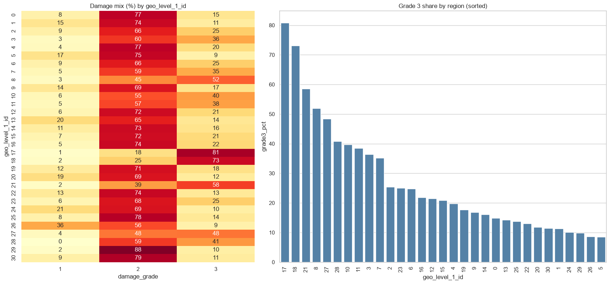
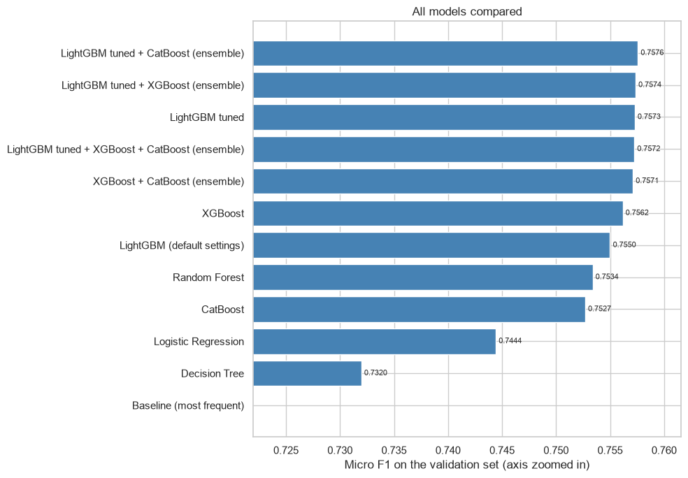
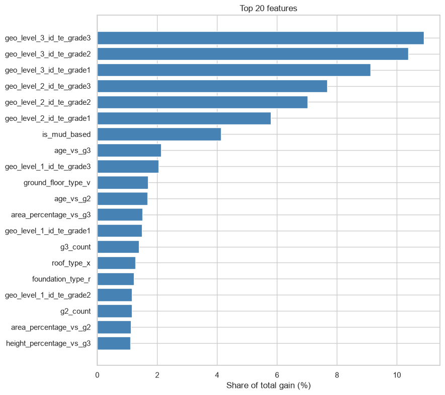
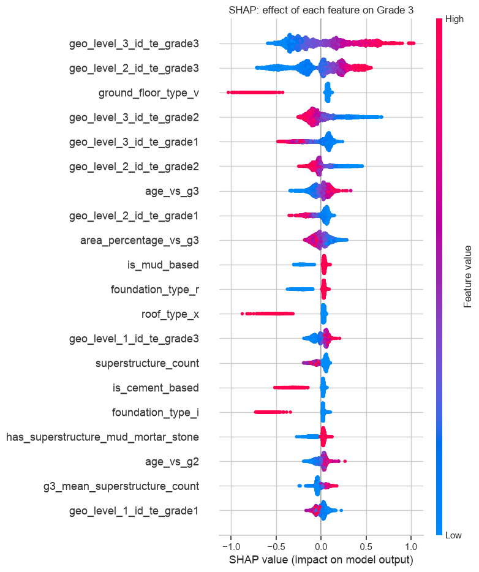

# Richter's Predictor: predicting earthquake damage in Nepal

In April 2015 the Gorkha earthquake damaged a huge number of buildings in Nepal. Afterwards, Kathmandu Living Labs and Nepal's Central Bureau of Statistics surveyed buildings across the affected districts, and DrivenData turned that survey into a practice competition: given a building's location and construction details, predict how badly it was damaged.

This repo is my attempt at it. The final model is a tuned LightGBM that scores a micro-F1 of **0.7573** on a held-out validation set and **0.7551** in 5-fold cross-validation. Guessing the most common grade for every building scores 0.5689, for comparison.

Everything is in one notebook, [`richters_predictor.ipynb`](richters_predictor.ipynb), from cleaning and EDA through to modeling, tuning and the final predictions. The outputs are saved in it, so you can read it on GitHub without running anything.

## The task

Each building gets a damage grade: 1 (low), 2 (medium) or 3 (almost complete destruction). The metric is micro-averaged F1.

The training set has 260,601 buildings and 38 features: three nested region IDs, number of floors, age, footprint area and height, eleven yes/no columns for what the structure is made of, foundation, roof and floor types, and a few flags for secondary use (a shop, a school, and so on). The category values are anonymised letters, so I can tell you that "foundation type r" matters, but not what it is.

The classes are imbalanced: 9.6% Grade 1, 56.9% Grade 2 and 33.5% Grade 3.

The data is not in this repo because it belongs to the competition. You can download it from the [competition page](https://www.drivendata.org/competitions/57/nepal-earthquake/).

## What I did

**Cleaning.** The data is tidy: no missing values and every yes/no column really is 0 or 1. The one real problem is `age`. 1,390 buildings are listed as 995 years old and several hundred more are between 105 and 200, which are clearly placeholders. I treated anything above 100 as unknown (0.8% of buildings), replaced it with the training median and added an `age_unknown` flag in case the missing age is informative on its own. I kept the 12,319 rows that look identical apart from their ID, since many different buildings genuinely share the same description. All of this lives in one `clean_data()` function, so the test set gets exactly the same treatment.

**EDA.** Two things drive damage: what the building is made of and where it is. Buildings with mud mortar and stone walls (the most common type by far) ended up in Grade 3 38.2% of the time. For engineered reinforced concrete it was 1.8%. Regions differ even more, with the Grade 3 share going from 8.6% in the safest region to 80.8% in the worst.



**Features.** I added grouped material flags (mud-based, cement-based, reinforced concrete), height per floor, age buckets and a couple of interaction flags such as old mud buildings. The region IDs needed more care. They look like numbers but they are names, and the two finer levels have over a thousand values each. I target-encoded them out-of-fold, so a building is never encoded using its own label. I also added "neighbourhood" features that use no labels at all: how many buildings were surveyed in a region, their average age and height, the share of mud buildings, and how each building compares with its neighbours.

**Models.** Logistic regression, decision tree, random forest, XGBoost, LightGBM and CatBoost, each wrapped in an sklearn pipeline so that the encoders are fitted inside every cross-validation fold. I tuned LightGBM with Optuna (30 trials) and tried averaging the probabilities of the best models.

## Results

All scores are micro-F1 on the same 20% validation split.

| Model | Micro F1 |
|---|---|
| Always predict Grade 2 | 0.5689 |
| Decision tree | 0.7320 |
| Logistic regression | 0.7444 |
| CatBoost | 0.7527 |
| Random forest | 0.7534 |
| LightGBM (default settings) | 0.7550 |
| XGBoost | 0.7562 |
| **LightGBM (tuned)** | **0.7573** |
| LightGBM + CatBoost, averaged | 0.7576 |



A few things I found along the way:

- **The ensemble was not worth it.** It beat the tuned LightGBM by 0.0003, which is inside the noise between validation splits. I set a rule in advance (an ensemble has to win by at least 0.0005) and the single model won.
- **Tuning helped a little.** It took LightGBM from 0.7550 to 0.7573. The top models are all so close that I think more gains need new information, not a different algorithm.
- **The neighbourhood features helped more.** Before adding them, the tuned LightGBM scored 0.7544 on validation and 0.7514 in cross-validation. With them it is 0.7573 and 0.7551.
- **Class weights hurt the score I was being judged on.** With `class_weight='balanced'`, Grade 1 recall went from 0.575 to 0.830 but micro-F1 dropped from 0.7550 to 0.7207, so I left them off.
- **Mistakes are near-misses.** 98.6% of wrong predictions are off by one grade. Only 1.4% mix up Grade 1 and Grade 3. Grade 1 is the weak spot, with a recall of 0.57.

## What the model picked up

The target-encoded region columns take the top six spots in the feature importance chart, followed by whether the building is mud-based. The neighbourhood features make up about a quarter of the total gain.



The SHAP plot shows the direction of each effect. A building in a region with a high Grade 3 rate is pushed strongly towards Grade 3, and a few construction categories push firmly the other way.



## Repo contents

```
richters_predictor.ipynb   the whole project, with outputs
requirements.txt           Python packages
images/                    charts used in this README
```

Running the notebook also writes `model_comparison.csv`, `final_models.joblib` and `submission.csv` to the same folder.

## Running it

You need Python 3.10 or newer.

```bash
git clone https://github.com/badal-10tech/<repo-name>.git
cd <repo-name>
python -m venv venv
source venv/bin/activate        # on Windows: venv\Scripts\activate
pip install -r requirements.txt
```

Download `train_values.csv`, `train_labels.csv` and `test_values.csv` from the competition page and put them in the same folder as the notebook, then open `richters_predictor.ipynb` and run it top to bottom.

A full run takes one to two hours on my laptop. Most of that is hyperparameter tuning (about 27 minutes) and CatBoost (about 11 minutes). If you only want to check that everything works, set `QUICK_MODE = True` in the configuration cell. It uses a 40,000-row sample and finishes in a few minutes, with lower scores.

## Limitations

- The categories are anonymised, so I cannot connect the findings to real building types.
- I used one random validation split, plus cross-validation for the final model only. I did not repeat the full model comparison under cross-validation.
- The model learns from a single earthquake and depends heavily on region, so I would not expect it to carry over to a different event.
- The damage grades are ordered, but I treated them as three separate classes.

## Ideas for next time

- An ordinal approach, for example two stacked classifiers for "worse than Grade 1" and "worse than Grade 2".
- A dashboard of damage by region and material.
- A small web app that takes building details and returns a predicted grade.

## Credits

Data and problem by DrivenData, from the survey by Kathmandu Living Labs and Nepal's Central Bureau of Statistics. Check the competition page for the data terms before reusing it.

Made by Badal Singh Dashmer ([github.com/badal-10tech](https://github.com/badal-10tech)).
